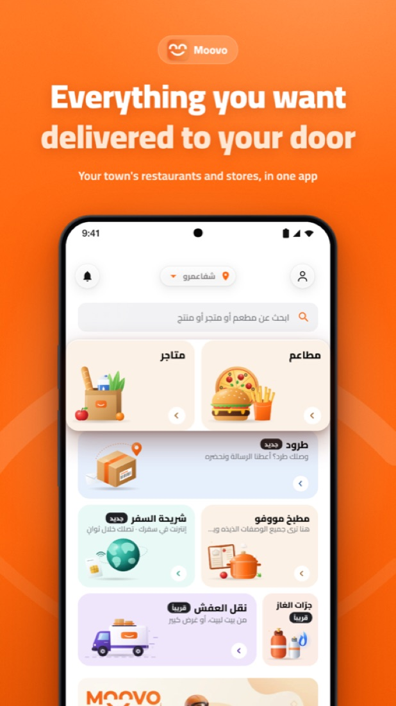
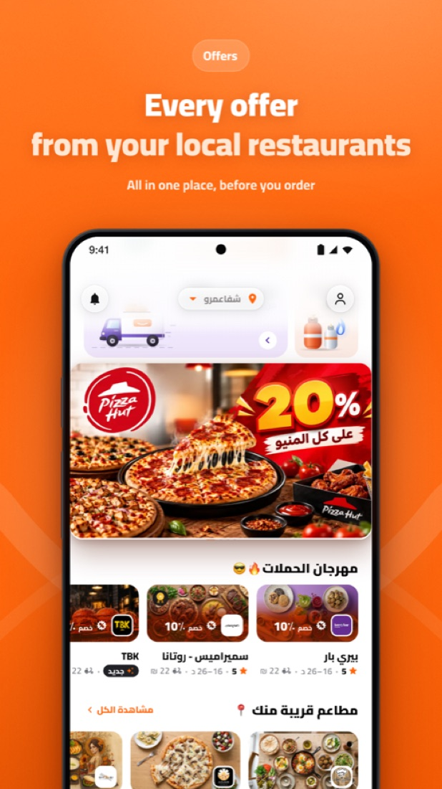
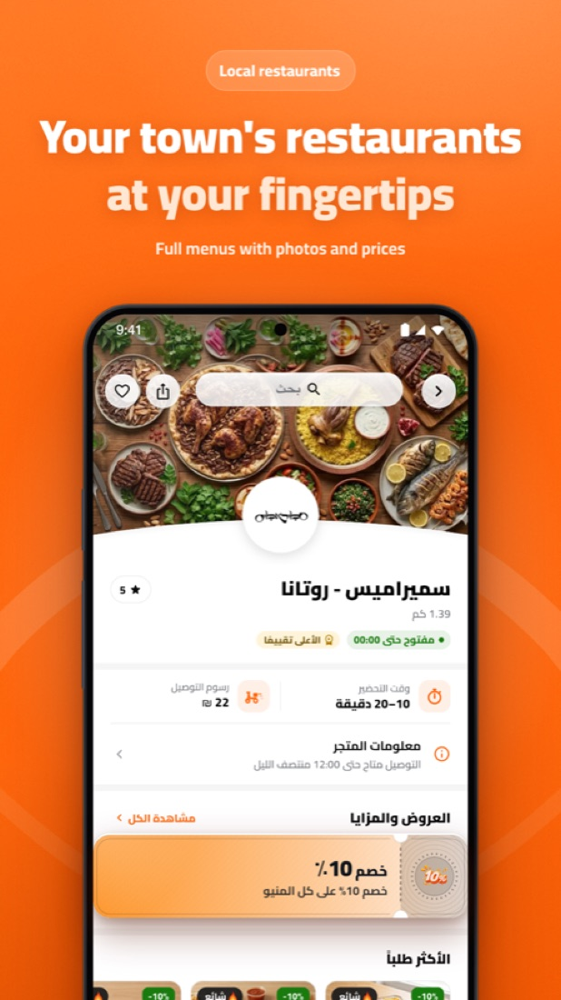
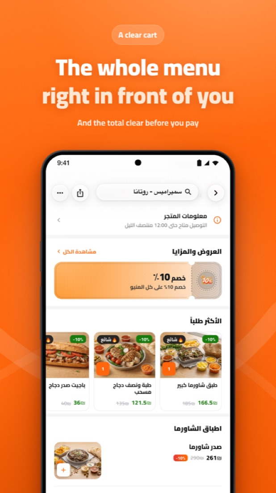
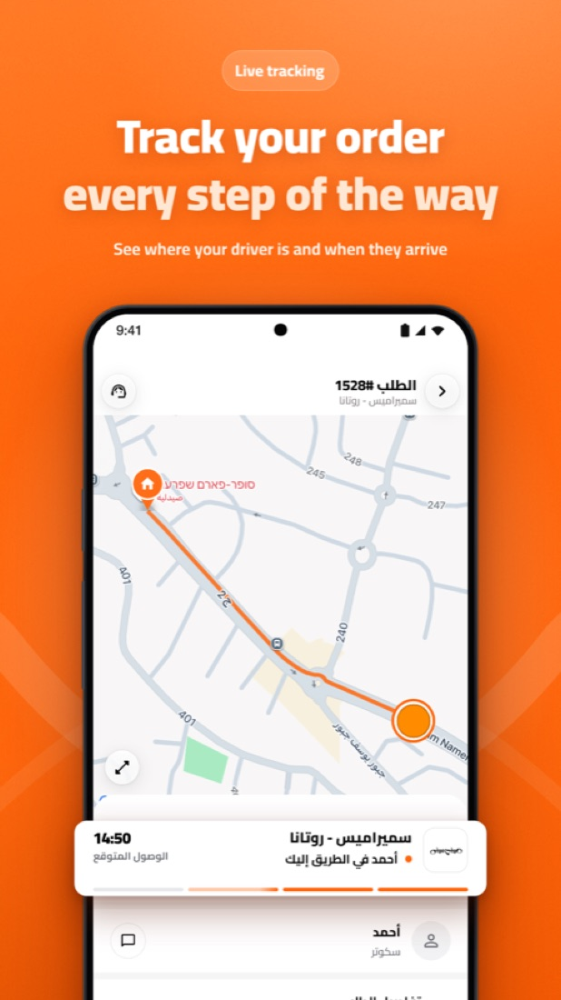
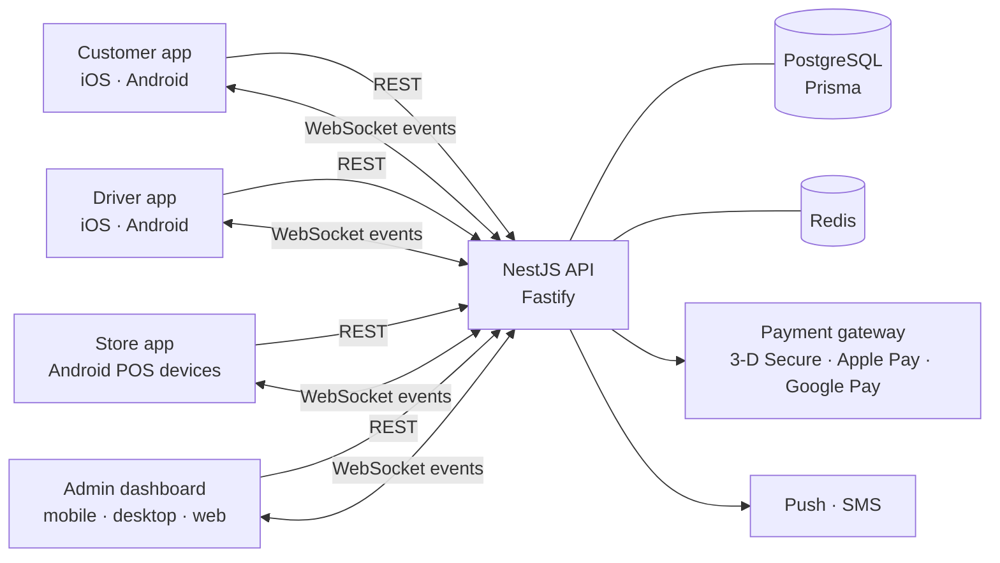

# Moovo — a delivery marketplace, built end to end

**Moovo** is a live delivery marketplace: restaurants, grocery stores, parcels and travel eSIMs, ordered from one app and delivered by our own drivers.
I co-founded it and, as CTO, designed, built and run the whole platform — four Flutter apps, the NestJS backend, the payments, the release pipelines and the fleet of in-store devices.

  
  
  
  
  

> The source code is private — Moovo is a live commercial product. This page describes what I built and how. I'm happy to walk through the architecture and the code in an interview.

---

## The platform

| Piece | What it does | Built with |
|---|---|---|
| **Customer app** | Browse stores and restaurants, offers, cart, card and wallet payments, live order tracking | Flutter (iOS + Android) |
| **Driver app** | Receive and accept jobs, step-by-step delivery flow, navigation, cash handling | Flutter (iOS + Android) |
| **Store app** | Accept and prepare orders, print tickets, manage menu, products, offers and opening hours | Flutter on Android point-of-sale devices |
| **Admin dashboard** | Live operations board, dispatch, finance, statements, staff, support | Flutter (iOS, Android, macOS, Windows, web) |
| **API** | Orders, dispatch, payments, ledger, notifications, real-time events | NestJS on Fastify, PostgreSQL + Prisma, Redis, Socket.IO |

The customer, driver and store apps share one Dart models package, so a change to an order or a store is made once and every app speaks the same language as the API.

## Engineering highlights

**Live order tracking.** Every order is a real-time room: the customer, the store, the driver and the operations team see the same state change the moment it happens. Each app owns its socket lifecycle — reconnecting when the phone wakes, the network returns or the app comes back to the foreground — so nobody is left looking at a stale order.

**Payments.** Card payments with 3-D Secure, Apple Pay, Google Pay and a local mobile wallet. The operations team sees payments that are in flight right now, and cancelled card orders are compensated automatically.

**A money engine people can trust.** Every payment moves through a ledger. Stores and drivers get settlement statements per business day, with commission rules, discounts funded by different parties, tips and entry fees — and the dashboard's profit numbers come from the same single equation as the statements, so the two never disagree. Days are computed in local time end to end, not server time.

**Push notifications you can verify.** Phones report back when a notification actually arrives, so the team can see, per order, whether the customer, store or driver was really reached — not just whether we sent it.

**In-store devices as a managed fleet.** Store devices are provisioned by QR code as managed Android devices: the app updates itself remotely, the time zone and keyboard are set centrally (including a custom Arabic keyboard), and the device can't drift into an unusable state.

**Product photos without a photographer.** Stores photograph products on the device; the background is removed on the phone (Apple Vision / ML Kit) and the server normalises every image onto a clean white catalogue frame.

**Shipping.** GitHub Actions builds and ships the apps to Google Play and TestFlight; Crashlytics and an in-app error log tell us what broke and for whom; the admin dashboard pushes an iOS Live Activity for the operations board.

## How the code is organised

- **Clean architecture** in every Flutter app: data / domain / presentation per feature, **BLoC** for state, dependency injection with `injectable`.
- **A shared models package** used by the three mobile apps.
- **Tests:** about 280 test files in the customer app and about 580 spec files in the API, plus type checks and spec runs in GitHub Actions.
- **Arabic-first, right-to-left UI**, translated into English, Hebrew and more.

## My role

Co-founder & CTO — product, architecture, every app, the backend, the infrastructure and the releases. Before Moovo I led the three Flutter apps of **SALA Delivery** (60K+ weekly users), where I took the apps from 67 to 116 FPS and set up CI/CD to both stores.

📫 [LinkedIn](https://www.linkedin.com/in/mohamadabudaya/) · [GitHub](https://github.com/MohamadAbudaya97)
